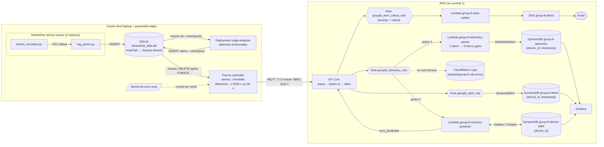

# Pipeline AWS IoT Core → DynamoDB

Ce document décrit la mise en place de la chaîne complète entre l'edge (cluster kind) et AWS :

```
simulateur → log_parser → SQLite → iot-controller ──MQTT/TLS──▶ AWS IoT Core ──Rule──▶ Lambda ──▶ DynamoDB
                             └──▶ edge-analyser ──alertes──▶ iot-controller ──▶ IoT Core ──Rules──▶ DynamoDB + email
```

État : **fonctionnel de bout en bout**, avec détection d'anomalies à l'edge, prédiction de panne mémoire dans le cloud, alertes par email et dashboard Grafana.

## Architecture



Points clés :

- **Pattern passerelle** : seul le contrôleur est un « Thing » IoT Core. Les machines à café sont identifiées par `device_id` dans les données, pas par une identité MQTT. Un seul certificat et une seule connexion par site.
- **Store-and-forward** : si la connexion tombe, les lignes (et les alertes) restent dans SQLite et sont renvoyées plus tard. Une ligne n'est supprimée qu'après l'ACK (PUBACK) du broker.
- **Livraison au moins une fois** : un batch peut arriver deux fois (ACK perdu), mais la clé DynamoDB `(device_id, timestamp)` rend l'écriture idempotente → pas de doublons dans la table.
- **IoT Core ne stocke rien** : sans Rule, les messages sont acquittés puis perdus.
- **Ce qui est urgent se décide à l'edge, ce qui demande de l'historique dans le cloud** : une surchauffe laisse ~24 s, moins que la latence du batching (jusqu'à 60 s) → détection à l'edge. Une panne mémoire se prépare sur plusieurs heures → prédiction dans le cloud.

## Noms des ressources

Tout est préfixé `group-8` car le compte AWS peut être partagé (un client ID MQTT identique entre deux groupes provoquerait des déconnexions mutuelles).

| Ressource | Nom |
|---|---|
| Région | `eu-central-1` (Francfort) |
| IoT Policy | `group-8-iot-gateway-policy` |
| IoT Thing | `group-8-iot-gateway-01` |
| Client ID MQTT | `group-8-iot-controller` |
| Topic MQTT télémétrie | `group-8/iot/devices/batch` |
| Topic MQTT alertes | `group-8/iot/devices/alert` |
| Tables DynamoDB | `group-8-telemetry`, `group-8-alerts`, `group-8-device-state` |
| Lambdas | `group-8-telemetry-parser`, `group-8-memory-predictor`, `group-8-alert-notifier` |
| Policies IAM des Lambdas (inline) | `group-8-telemetry-write`, `group-8-memory-predictor-access`, `group-8-alert-notify` |
| IoT Rules | `group8_telemetry_rule`, `group8_alert_rule`, `group8_alert_critical_rule` (les `-` sont interdits dans les noms de règles) |
| Rôle IAM de l'action DynamoDBv2 (alertes) | `group-8-iot-alerts-ddb-role` |
| Topic SNS | `group-8-alerts` |
| Log group erreurs des règles | `/aws/iot/group-8-rule-errors` |
| Rôle IAM de l'action d'erreur | `group-8-iot-rule-errors-role` |
| Utilisateur IAM Grafana | `group-8-grafana-reader` (policy `group-8-grafana-dynamodb-read`) |
| Secret Kubernetes | `iot-core-certs` |
| Images Docker Hub | `madeinshinea/cloud-project:controller-1.1.0`, `…:worker-1.0.0`, `…:edge-analyser-1.0.0` |

## 1. AWS IoT Core

### Policy

`IoT Core → Security → Policies → Create policy` (JSON). Moindre privilège : uniquement se connecter avec notre client ID et publier sur nos deux topics.

```json
{
  "Version": "2012-10-17",
  "Statement": [
    { "Effect": "Allow", "Action": "iot:Connect",
      "Resource": "arn:aws:iot:eu-central-1:<ACCOUNT_ID>:client/group-8-iot-controller" },
    { "Effect": "Allow", "Action": "iot:Publish",
      "Resource": [
        "arn:aws:iot:eu-central-1:<ACCOUNT_ID>:topic/group-8/iot/devices/batch",
        "arn:aws:iot:eu-central-1:<ACCOUNT_ID>:topic/group-8/iot/devices/alert"
      ] }
  ]
}
```

`<ACCOUNT_ID>` : `aws sts get-caller-identity --query Account --output text`.

Pour modifier une policy existante : `Edit active version` → JSON → cocher *Set the edited version as the active version* → `Save as new version`. **À faire avant de déployer un contrôleur qui publie sur un nouveau topic** : IoT Core coupe la connexion sur une publication non autorisée, ce qui bloque aussi la télémétrie.

### Thing et certificat

`IoT Core → Manage → All devices → Things → Create things → Create single thing` (et **pas** l'assistant « Connect one device », qui crée une policy de démo `sdk/test/*` inutilisable ici).

- Nom : `group-8-iot-gateway-01`, pas de shadow
- *Auto-generate a new certificate*
- Attacher la policy `group-8-iot-gateway-policy`
- **Télécharger immédiatement** le certificat, la clé privée et Amazon Root CA 1 (la clé privée n'est plus téléchargeable ensuite)

Les fichiers sont rangés dans `edge-device/deployment/certs/` (ignoré par git) :

```
certs/
├── AmazonRootCA1.pem    # vérifie l'identité d'AWS
├── device.pem.crt       # identité du contrôleur
└── private.pem.key      # preuve de possession (chmod 600, ne jamais commiter)
```

La clé publique et Root CA 3 (certificats ECC) ne sont pas nécessaires.

### Endpoint

```nu
aws iot describe-endpoint --endpoint-type iot:Data-ATS --region eu-central-1
```

### Test de connexion sans le code

Abonnement dans `IoT Core → MQTT test client` à `group-8/iot/devices/batch`, puis depuis `edge-device/deployment/certs` (Nushell) :

```nu
docker run --rm -v $"($env.PWD):/c" docker.io/library/eclipse-mosquitto mosquitto_pub --cafile /c/AmazonRootCA1.pem --cert /c/device.pem.crt --key /c/private.pem.key -h (aws iot describe-endpoint --endpoint-type iot:Data-ATS --region eu-central-1 | from json | get endpointAddress) -p 8883 -i group-8-iot-controller -t group-8/iot/devices/batch -m '{"rows":["hello"]}' -q 1 -d
```

Ce test valide certificat, policy, endpoint et réseau indépendamment du code Python.

## 2. Contrôleur edge (`edge-device/deployment/iot-controller/controller.py`)

### Changements

| Changement | Raison |
|---|---|
| `CLIENT_ID`, `GATEWAY_ID`, `CA_CERT`, `CERT_FILE`, `KEY_FILE`, `MAX_WAIT`, `PUBLISH_TIMEOUT` en variables d'environnement | Client ID imposé par la policy ; chemins des certificats différents entre laptop et pod |
| TLS mutuel activé seulement si `CA_CERT` est défini | La même image fonctionne avec Mosquitto en local (sans TLS) |
| `mqtt.Client(mqtt.CallbackAPIVersion.VERSION2, …)` | Requis par paho-mqtt 2.x |
| Payload `{"gateway": "...", "rows": [...]}` en JSON compact | Un objet JSON est plus simple à traiter dans la Rule et la Lambda qu'un tableau nu |
| Calcul exact de la taille du payload (enveloppe + virgules) | Ne jamais dépasser 5 KB |
| Envoi si **batch plein** OU **plus vieille ligne > `MAX_WAIT`** | Voir « Coût du batching » |
| `wait_for_publish(timeout)` + suppression seulement si `is_published()` | Pas de perte de données ni de blocage infini si la connexion tombe |
| Callbacks `on_connect` / `on_disconnect` | IoT Core coupe la connexion sans message en cas de refus de policy |
| *(1.1.0)* Envoi des alertes de la table `alerts` **avant** la télémétrie, un message par alerte sur `ALERT_TOPIC` | Une alerte n'attend pas le batch ; un message par alerte permet à la Rule de l'écrire directement dans DynamoDB |
| *(1.1.0)* Télémétrie limitée aux lignes `id <= checkpoint` de l'analyseur | Une ligne n'est jamais supprimée avant d'avoir été analysée |
| *(1.1.0)* Checkpoint ignoré si le heartbeat de l'analyseur a plus de `ANALYZER_TIMEOUT` s | Un analyseur en panne ne bloque pas la télémétrie |

La table `alerts` n'est que **lue** toutes les 2 s (lecture locale, gratuite) : aucun message n'est envoyé s'il n'y a pas d'alerte.

### Coût du batching

IoT Core facture les messages **par tranche de 5 KB** : un message de 700 o coûte autant qu'un message de 5 KB, et un message de 6 KB compte double.

- Avant : envoi à chaque poll (~10 lignes / 10 s) → ~8 640 messages/jour pour 2 machines
- Après : batch rempli jusqu'à ~5000 o ou envoyé après 60 s → ~1 440 messages/jour, soit **~6× moins cher**
- Contrepartie : jusqu'à ~60 s de latence avant que les données arrivent dans le cloud (d'où la détection des surchauffes à l'edge)

Un batch typique : ~62 lignes, ~4,3 KB, envoyé toutes les ~62 s.

### Variables d'environnement (pod)

| Variable | Valeur |
|---|---|
| `MQTT_HOST` | endpoint ATS (`…-ats.iot.eu-central-1.amazonaws.com`) |
| `MQTT_PORT` | `8883` |
| `CLIENT_ID` | `group-8-iot-controller` |
| `GATEWAY_ID` | `group-8-iot-gateway-01` |
| `TOPIC` | `group-8/iot/devices/batch` |
| `ALERT_TOPIC` | `group-8/iot/devices/alert` (non défini = alertes non envoyées) |
| `CA_CERT` / `CERT_FILE` / `KEY_FILE` | `/certs/AmazonRootCA1.pem`, `/certs/device.pem.crt`, `/certs/private.pem.key` |
| `DB_PATH` | `/shared/iot_data.db` |
| `MAX_BYTES` | `5000` |
| `MAX_WAIT` | `60` |
| `POLL_INTERVAL` | `2.0` |
| `ANALYZER_TIMEOUT` | `120` |

### Test local (hors Kubernetes)

Le contrôleur peut tourner directement sur le laptop, en lisant la base remplie par les workers via `/tmp/iot-shared`. Depuis la racine du projet, après avoir supprimé le pod contrôleur (un seul client par client ID) :

```nu
with-env {MQTT_HOST: (aws iot describe-endpoint --endpoint-type iot:Data-ATS --region eu-central-1 | from json | get endpointAddress), MQTT_PORT: "8883", CLIENT_ID: "group-8-iot-controller", GATEWAY_ID: "group-8-iot-gateway-01", TOPIC: "group-8/iot/devices/batch", ALERT_TOPIC: "group-8/iot/devices/alert", CA_CERT: "edge-device/deployment/certs/AmazonRootCA1.pem", CERT_FILE: "edge-device/deployment/certs/device.pem.crt", KEY_FILE: "edge-device/deployment/certs/private.pem.key", DB_PATH: "/tmp/iot-shared/iot_data.db", MAX_WAIT: "60"} { uv run --with paho-mqtt==2.1.0 python edge-device/deployment/iot-controller/controller.py }
```

## 3. Analyseur edge (`edge-device/deployment/edge-analyser/analyser.py`)

Pod séparé (ingestion / analyse / transport : un composant par rôle). Bibliothèque standard Python uniquement, **aucun accès réseau ni certificat** : il ne touche que SQLite.

### Fonctionnement

1. Toutes les secondes, lit les nouvelles lignes de `telemetry_logs` (`id > last_id`).
2. Un détecteur par `device_id` garde le dernier échantillon et applique les règles (voir [Types d'alertes](#types-dalertes)), **une alerte par épisode** et pas une par échantillon.
3. Écrit les alertes dans `alerts` et le checkpoint dans `analyzer_state` **dans la même transaction** : après un crash, aucune ligne n'est analysée deux fois ni oubliée.
4. Le contrôleur envoie les alertes et ne supprime que la télémétrie déjà analysée (`id <= last_id`).

Tables SQLite ajoutées :

| Table | Colonnes | Écrite par | Lue par |
|---|---|---|---|
| `alerts` | `id`, `payload` (JSON) | analyseur | contrôleur (supprime après PUBACK) |
| `analyzer_state` | `id = 0`, `last_id`, `heartbeat` (epoch s) | analyseur | contrôleur |

Délai de bout en bout pour une surchauffe : détection 2-4 s après le début de la montée + ≤ 2 s de polling du contrôleur + < 1 s jusqu'à IoT Core, soit **~5 s pour une fenêtre de ~24 s**.

### Déploiement

`deployment-edge-analyser.yaml` : Deployment avec **1 seul réplica** et stratégie `Recreate` (deux analyseurs dupliqueraient les alertes et se disputeraient le checkpoint). Monte le même `/shared` que les autres pods.

| Variable | Valeur | Rôle |
|---|---|---|
| `DB_PATH` | `/shared/iot_data.db` | |
| `POLL_INTERVAL` | `1.0` | s entre deux lectures |
| `TARGET_TEMP_C` / `TEMP_MARGIN_C` | `94.0` / `1.5` | seuil de surchauffe = 95,5 °C (bruit normal ±0,3 °C) |
| `CRITICAL_TEMP_C` | `112.0` | utilisé pour calculer `eta_s` |
| `WARN_FREE_BYTES` | `15000` | fin d'un épisode mémoire (heap remonté) |
| `SILENCE_TIMEOUT` | `20` | s sans donnée avant l'alerte `silent` |

Les seuils sont recopiés depuis `simulator/config.yaml` : à modifier des deux côtés.

### Validation

Simulateur exécuté hors ligne sur 48 h simulées, alertes comparées au `ground_truth.log` : **120/120 emballements thermiques prédits** (16-22 s avant l'erreur overheat), 11/11 OOM, 31/31 silences.

Limites connues : l'état des détecteurs est en mémoire (après un redémarrage, au pire une alerte manquée ou répétée) ; deux erreurs capsule/eau consécutives sur le même bit comptent pour une.

## 4. Déploiement Kubernetes

### Images (Docker Hub)

Un seul dépôt Docker Hub, les images sont distinguées par leur tag. Depuis la racine :

```nu
docker login docker.io -u madeinshinea      # mot de passe = access token Read & Write
docker build -t docker.io/madeinshinea/cloud-project:controller-1.1.0 edge-device/deployment/iot-controller
docker push docker.io/madeinshinea/cloud-project:controller-1.1.0
docker build -t docker.io/madeinshinea/cloud-project:worker-1.0.0 edge-device/deployment/simulator
docker push docker.io/madeinshinea/cloud-project:worker-1.0.0
docker build -t docker.io/madeinshinea/cloud-project:edge-analyser-1.0.0 edge-device/deployment/edge-analyser
docker push docker.io/madeinshinea/cloud-project:edge-analyser-1.0.0
```

Toujours utiliser un **nouveau tag** à chaque modification : avec `imagePullPolicy: IfNotPresent`, un nœud qui a déjà un tag ne le retélécharge jamais.

### Secret des certificats

Les certificats ne doivent être ni dans l'image (publique sur Docker Hub) ni dans le YAML (commité). Ils sont injectés via un Secret Kubernetes, monté en lecture seule sur `/certs` dans le pod. Depuis `edge-device/` :

```nu
kubectl create secret generic iot-core-certs --from-file=deployment/certs/AmazonRootCA1.pem --from-file=deployment/certs/device.pem.crt --from-file=deployment/certs/private.pem.key
```

Le Secret disparaît avec le cluster : à recréer après chaque `kind create cluster`. Un Secret n'est qu'encodé en base64 (pas chiffré) : acceptable pour kind en local.

### Cluster kind

Le cluster a 2 nœuds : `control-plane` et `worker`. Les deux montent le même dossier du laptop (`/tmp/iot-shared` → `/shared`), donc la base SQLite partagée par `hostPath` est la même quel que soit le nœud où tournent les pods.

Le passage à l'échelle se fait en ajoutant des passerelles (une par site, chacune avec son Thing et son certificat).

### Lancement (depuis `edge-device/`)

```nu
kind create cluster --config kind-config.yaml --name iot-cluster
kubectl create secret generic iot-core-certs --from-file=deployment/certs/AmazonRootCA1.pem --from-file=deployment/certs/device.pem.crt --from-file=deployment/certs/private.pem.key
kubectl apply -f deployment/statefulset-worker.yaml
kubectl apply -f deployment/deployment-edge-analyser.yaml
kubectl apply -f deployment/pod-iot-controller.yaml
kubectl logs -f iot-controller
```

Ou `./rebuild-and-deploy.sh` depuis `deployment/` : le Secret et la ConfigMap sont créés avec `create --dry-run=client -o yaml | kubectl apply -f -`, donc le script fonctionne sur un cluster neuf comme sur un cluster existant (et applique les changements de `simulator/config.yaml`).

Les variables d'environnement d'un Pod ne sont pas modifiables à chaud : pour mettre à jour le contrôleur, `kubectl delete -f` puis `kubectl apply -f`.

## 5. DynamoDB

### Table `group-8-telemetry`

`DynamoDB → Tables → Create table` :

| Paramètre | Valeur | Raison |
|---|---|---|
| Nom | `group-8-telemetry` | |
| Partition key | `device_id` (String) | Répartit les données par machine |
| Sort key | `timestamp` (Number, epoch ms) | Requête « machine X entre A et B » = lecture directe par clé, sans scan |
| Capacity mode | On-demand | Coût nul à l'arrêt, absorbe les rafales de ~60 écritures par batch sans throttling, rien à dimensionner. Modifiable plus tard (1×/24 h) |
| TTL | attribut `ttl` | Suppression automatique des vieilles lignes |

Remarques :

- `timestamp` est un **mot réservé** DynamoDB : écrire des items fonctionne normalement, mais dans les requêtes il faut l'échapper (`#ts` + `ExpressionAttributeNames` avec boto3, `"timestamp"` entre guillemets doubles en PartiQL, comme le nom de table `"group-8-telemetry"` à cause des `-`). Idem pour `type` dans la table des alertes.
- Le TTL exige des **secondes** epoch, alors que `timestamp` est en millisecondes : la Lambda écrit donc un attribut séparé `ttl`.
- Rétention : **90 jours** à partir du `timestamp` de chaque échantillon. La suppression par TTL est gratuite mais asynchrone (généralement sous quelques jours après expiration).

### Table `group-8-alerts`

| Paramètre | Valeur |
|---|---|
| Partition key | `device_id` (String) |
| Sort key | `timestamp` (Number, epoch ms de l'échantillon qui a déclenché l'alerte) |
| Capacity mode | On-demand |
| TTL | attribut `ttl`, calculé par la Rule (360 jours après réception) |

Les items sont écrits par l'action DynamoDBv2 de `group8_alert_rule` : chaque champ JSON de l'alerte devient une colonne (voir [Format d'une alerte](#format-dune-alerte)).

### Table `group-8-device-state`

| Paramètre | Valeur |
|---|---|
| Partition key | `device_id` (String), **pas de sort key** : un seul item par machine, réécrit à chaque batch |
| Capacity mode | On-demand |
| TTL | aucun |

Écrite par `group-8-memory-predictor` (voir [section 9](#9-lambda-group-8-memory-predictor)).

## 6. Lambda `group-8-telemetry-parser`

Code : [`cloud/lambda/telemetry-parser/lambda_function.py`](../cloud/lambda/telemetry-parser/lambda_function.py)

Pourquoi une Lambda : l'action DynamoDB native d'une Rule écrit **un item par message MQTT**. Or nos messages sont des batches de ~60 lignes CSV ; la Rule ne sait ni découper un tableau ni parser du CSV. La Lambda transforme chaque ligne en item typé :

```
"1792000000000,coffee-machine-0,28000,52.0,1400204.6,50030,preheat,0"
  → {device_id, timestamp, uptime_ms, temperature_c, power_consumption_mw,
     heap_free_bytes, device_status, error_code, gateway, ttl}
```

- Les lignes invalides sont ignorées et loguées (au lieu de faire échouer tout le batch).
- `batch_writer` regroupe les écritures en `BatchWriteItem` de 25 items.
- Les flottants passent par `Decimal` (boto3 refuse les `float`).

Pourquoi le parsing est dans le cloud et pas dans le contrôleur :

- L'edge n'a besoin que d'un certificat limité à un topic, pas de clés IAM capables d'écrire en base.
- Changer le schéma ou la base = redéployer la Lambda, pas mettre à jour chaque passerelle.
- Le CSV est compact : le convertir à l'edge en JSON grossirait les messages (2-3×) donc la facture IoT Core.
- Passer par une Rule permet d'ajouter d'autres actions plus tard (alertes, archivage S3) sans toucher l'edge.

### Configuration

| Paramètre | Valeur |
|---|---|
| Runtime | Python 3.x (dernière version) |
| Architecture | `arm64` (Graviton, ~20 % moins cher, aucun impact pour du Python pur) |
| Timeout | 10 s (3 s par défaut, trop court au démarrage à froid) |
| `TABLE_NAME` | `group-8-telemetry` |
| `RETENTION_DAYS` | `90` |
| Rôle | créé automatiquement (*basic Lambda permissions* → logs CloudWatch) + policy inline `group-8-telemetry-write` |

Policy inline `group-8-telemetry-write` (écriture sur cette seule table) :

```json
{
  "Version": "2012-10-17",
  "Statement": [
    {
      "Effect": "Allow",
      "Action": ["dynamodb:BatchWriteItem", "dynamodb:PutItem"],
      "Resource": "arn:aws:dynamodb:eu-central-1:<ACCOUNT_ID>:table/group-8-telemetry"
    }
  ]
}
```

L'ARN de la table se trouve dans `DynamoDB → Tables → group-8-telemetry → Overview → General information → Additional info`.

### Déploiement depuis le repo

Depuis `cloud/lambda/telemetry-parser/` (le zip est ignoré par git) :

```nu
python -m zipfile -c function.zip lambda_function.py
aws lambda update-function-code --function-name group-8-telemetry-parser --zip-file fileb://function.zip --region eu-central-1
```

Ou dans la console : onglet *Code*, coller le fichier, **Deploy** (valable pour toutes les Lambdas de ce document).

### Test isolé

Événement de test `sample-batch` dans l'onglet *Test* :

```json
{
  "gateway": "group-8-iot-gateway-01",
  "rows": [
    "1792000000000,coffee-machine-0,28000,52.0,1400204.6,50030,preheat,0",
    "1792000002000,coffee-machine-0,30000,55.5,1399767.0,49893,standby,0",
    "1792000000000,coffee-machine-1,12000,90.1,1500000.0,48000,error,1",
    "this,is,not,valid"
  ]
}
```

Résultat attendu : `{"written": 3, "skipped": 1}` et 3 items dans la table.

## 7. IoT Rule `group8_telemetry_rule`

`IoT Core → Message routing → Rules → Create rule` (et cliquer **Create** à la dernière étape de l'assistant, sinon la règle n'existe pas).

| Paramètre | Valeur |
|---|---|
| SQL version | `2016-03-23` |
| SQL | `SELECT * FROM 'group-8/iot/devices/batch'` (guillemets simples) |
| Action 1 | Lambda → `group-8-telemetry-parser` (la console ajoute la permission d'invocation pour `iot.amazonaws.com`) |
| Action 2 | Lambda → `group-8-memory-predictor` |
| Error action | CloudWatch Logs → `/aws/iot/group-8-rule-errors`, rôle `group-8-iot-rule-errors-role`, **batch mode désactivé** |

- Les actions sont indépendantes : si le prédicteur échoue, la télémétrie est quand même stockée.
- L'action d'erreur reçoit un objet JSON par échec ; le *batch mode* attend un tableau d'entrées de log et ferait échouer l'action d'erreur elle-même.
- Rétention des log groups (`/aws/iot/group-8-rule-errors` et `/aws/lambda/…`) : 2 semaines (par défaut *Never expire*).
- Une règle ne s'applique qu'aux messages publiés **après** sa création.

## 8. Alertes

### Types d'alertes

| Alerte (`type`) | Origine | Déclencheur | Sévérité | Email | Avance sur la panne |
|---|---|---|---|---|---|
| `overheat_predicted` | edge | température > 95,5 °C **et** en hausse, machine en chauffe | **critical** | oui | **16-22 s** avant l'erreur overheat, `eta_s` estimé |
| `error` + `overheat` | edge | bit 1 de `error_code` activé | **critical** | oui | 0 (panne en cours, reboot imminent) |
| `error` + `out_of_memory` | edge | bit 2 de `error_code` activé | **critical** | oui | 0 (panne en cours, reboot imminent) |
| `oom_predicted` | cloud (`memory-predictor`) | il ne reste que `ALERT_AT_UPDATES_LEFT` mise(s) à jour avant le crash | **critical** | oui | **~50 min** (±8 min) avec le réglage par défaut |
| `degraded` (`cause: temperature`) | edge | passage en statut `degraded` (≥ 102 °C) | warning | non | ~12 s |
| `degraded` (`cause: memory`) | edge | passage en statut `degraded` (heap < 15000 o), une fois par épisode | warning | non | ~1 cycle d'alimentation (40-55 min) |
| `silent` | edge | aucune donnée d'une machine depuis 20 s | warning | non | perte de connexion ou machine bloquée |
| `resumed` | edge | données reçues après un `silent` (`silent_s` = durée) | info | non | |
| `error` + `capsule_jam` / `no_water` / `no_capsule` | edge | bit 4 / 8 / 16 de `error_code` activé | info | non | imprévisibles par conception (bruit) |

Les erreurs transitoires (capsule, eau) n'ont aucun signe avant-coureur dans les données : elles sont stockées et comptées, mais ne déclenchent pas d'email.

### Format d'une alerte

Un message JSON par alerte sur `group-8/iot/devices/alert` :

```json
{"device_id":"coffee-machine-0","timestamp":1793381522667,"type":"overheat_predicted",
 "severity":"critical","temperature_c":97.0,"eta_s":10,"gateway":"group-8-iot-gateway-01"}
```

| Champ | Présent pour | Contenu |
|---|---|---|
| `device_id`, `timestamp`, `type`, `severity`, `gateway` | toutes | `timestamp` = epoch ms de l'échantillon déclencheur |
| `temperature_c` | `overheat_predicted`, `error`, `degraded` | température au moment de l'alerte |
| `eta_s` | `overheat_predicted`, `oom_predicted` | secondes estimées avant la panne |
| `errors`, `error_code` | `error` | noms des nouveaux bits, valeur brute du bitfield |
| `heap_free_bytes` | `error`, `degraded` | heap libre |
| `cause` | `degraded` | `temperature` ou `memory` |
| `last_seen` / `silent_s` | `silent` / `resumed` | dernier échantillon reçu / durée du silence |
| `value`, `updates_left`, `predicted_oom_ts` | `oom_predicted` | heap au repos, mises à jour restantes, instant estimé du crash |
| `ttl` | toutes (ajouté par la Rule) | epoch s, suppression après 360 jours |

### Rule `group8_alert_rule` (stockage)

| Paramètre | Valeur |
|---|---|
| SQL | `SELECT *, floor(timestamp() / 1000) + 31104000 AS ttl FROM 'group-8/iot/devices/alert'` |
| Action | DynamoDBv2 → `group-8-alerts`, rôle `group-8-iot-alerts-ddb-role` (créé par la console) |
| Error action | CloudWatch Logs → `/aws/iot/group-8-rule-errors` |

`timestamp()` est la fonction IoT SQL (heure de réception), pas le champ `timestamp` de l'alerte. L'action DynamoDBv2 suffit ici (pas de Lambda) car chaque message contient **une seule** alerte.

### Rule `group8_alert_critical_rule` (email)

| Paramètre | Valeur |
|---|---|
| SQL | `SELECT * FROM 'group-8/iot/devices/alert' WHERE severity = 'critical'` |
| Action | Lambda → `group-8-alert-notifier` |
| Error action | CloudWatch Logs → `/aws/iot/group-8-rule-errors` |

Deux règles sont nécessaires car une règle n'a qu'un seul `WHERE` : tout est stocké, seul le critique est envoyé par email.

### Topic SNS `group-8-alerts`

Type **Standard** (les topics FIFO ne supportent pas l'email), abonnement *Email* à confirmer via le lien reçu (sinon *Pending confirmation* et aucun email).

### Lambda `group-8-alert-notifier`

Code : [`cloud/lambda/alert-notifier/lambda_function.py`](../cloud/lambda/alert-notifier/lambda_function.py)

L'action SNS native d'une Rule ne peut transmettre que le JSON brut, avec le sujet « AWS Notification Message ». La Lambda met en forme le sujet et le corps puis publie sur SNS :

```
Subject: [CRITICAL] coffee-machine-0: Overheat predicted

An alert was raised on machine coffee-machine-0 at 2026-10-30 18:32:02 CET.

Type:      Overheat predicted
Severity:  CRITICAL
Gateway:   group-8-iot-gateway-01

Temperature is 97.0 °C and rising. The overheat limit (112 °C) is expected in about 10 s.
```

Pour une alerte `error`, le titre (sujet et ligne *Type*) est complété avec le nom des pannes de la liste `errors`, pour savoir laquelle s'est produite sans ouvrir l'email :

| `errors` | Titre |
|---|---|
| `["overheat"]` | `Error: Overheat` |
| `["out_of_memory"]` | `Error: Out of memory` |
| `["overheat", "capsule_jam"]` | `Error: Overheat + Capsule jam` (plusieurs bits activés sur le même échantillon) |

```
Subject: [CRITICAL] coffee-machine-0: Error: Overheat

Type:      Error: Overheat
Severity:  CRITICAL
Gateway:   group-8-iot-gateway-01

The machine reported: overheat (heater did not cut off). Temperature 112.23 °C, free memory 49920 bytes.
```

L'analyseur garde un seul `type: "error"` avec la liste `errors` : deux pannes simultanées en alertes séparées auraient la même clé `(device_id, timestamp)` et s'écraseraient dans `group-8-alerts`. Le détail n'est donc mis en forme que dans l'email.

| Paramètre | Valeur |
|---|---|
| Runtime / architecture / timeout | Python 3.x, `arm64`, 10 s |
| `SNS_TOPIC_ARN` | ARN du topic `group-8-alerts` |
| `TIMEZONE` | `Europe/Zurich` (UTC si le runtime n'a pas les données de fuseau) |
| Policy inline | `group-8-alert-notify` |

```json
{
  "Version": "2012-10-17",
  "Statement": [
    { "Effect": "Allow", "Action": "sns:Publish",
      "Resource": "arn:aws:sns:eu-central-1:<ACCOUNT_ID>:group-8-alerts" }
  ]
}
```

Les titres sont dans `TITLES` (par type) et `ERROR_TITLES` (par panne), le texte de chaque type d'alerte dans `describe()` : modifier, recoller dans la console, **Deploy**.

### Test sans l'edge

`IoT Core → MQTT test client` → *Publish to a topic* `group-8/iot/devices/alert` :

```json
{"device_id":"test-device","timestamp":1800000000000,"type":"overheat_predicted","severity":"critical","temperature_c":97.0,"eta_s":10,"gateway":"manual-test"}
```

Attendu : un item `test-device` dans `group-8-alerts` (avec `ttl`) et un email formaté. Avec `"severity":"info"` : l'item, mais pas d'email.

Erreur de surchauffe (email `Error: Overheat`) :

```json
{"device_id":"test-device","timestamp":1800000000000,"type":"error","severity":"critical","errors":["overheat"],"error_code":1,"temperature_c":112.2,"heap_free_bytes":49920,"gateway":"manual-test"}
```

Supprimer ensuite les items de test (même `timestamp` = même clé : le deuxième message remplace le premier dans la table).

## 9. Lambda `group-8-memory-predictor`

Code : [`cloud/lambda/memory-predictor/lambda_function.py`](../cloud/lambda/memory-predictor/lambda_function.py)

### Principe

Chaque mise à jour firmware perd ~8000 o de heap qui ne sont pas récupérés au reboot normal. Le heap descend en escalier (50k → 42k → 34k → 26k → 18k → 10k) et la machine crashe pendant la mise à jour suivante (< 5000 o), puis repart à 50k. Le phénomène se prépare sur plusieurs heures : la prédiction se fait dans le cloud.

Une invocation ne voit qu'un batch (~60 s) : l'état de chaque machine est conservé dans `group-8-device-state`. À chaque batch, pour chaque machine :

1. Charger l'item de la machine et **ignorer les lignes déjà vues** (`timestamp <= last_ts`, livraison au moins une fois).
2. **Baseline** = heap max des lignes hors `brewing` et hors erreur (le brewing ne fait que baisser le heap).
3. **Taille de la fuite** apprise à chaque chute de baseline ≥ 2000 o (`step_bytes`).
4. **Intervalle entre mises à jour** appris (moyenne glissante) à chaque passage en `updating` (`update_interval_s`). La relance immédiate d'une mise à jour après un crash est ignorée.
5. **Prédiction** :
   - `updates_left = ceil((baseline − 5000) / step)`
   - `predicted_oom_ts = prochaine mise à jour + (updates_left − 1) × intervalle + 80 s`
6. Quand `updates_left <= ALERT_AT_UPDATES_LEFT` : publication d'**une** alerte `oom_predicted` sur le topic d'alerte (même chemin que les alertes edge : table + email).
7. Après un crash (bit `out_of_memory`) : remise à zéro de la baseline et de l'alerte.

La première prédiction de date n'apparaît qu'après **deux mises à jour observées** (~1,5 h), le temps d'apprendre l'intervalle.

### Contenu de `group-8-device-state`

| Attribut | Contenu |
|---|---|
| `device_id` | clé |
| `baseline_heap` | heap libre au repos (o) |
| `step_bytes` | heap perdu par mise à jour (appris) |
| `update_interval_s` | temps moyen entre deux mises à jour |
| `updates_left` | mises à jour restantes avant le crash |
| `predicted_oom_ts` | instant estimé du crash (epoch ms) |
| `oom_count` | nombre de crashs mémoire observés |
| `last_ts`, `last_status`, `last_update_ts`, `baseline_at_update`, `notified`, `updated_at` | état interne |

### Configuration

| Paramètre | Valeur |
|---|---|
| Runtime / architecture / timeout | Python 3.x, `arm64`, 10 s |
| Concurrence réservée | **1** |
| `STATE_TABLE` | `group-8-device-state` |
| `IOT_ENDPOINT` | endpoint ATS (le même que `MQTT_HOST`) |
| `ALERT_TOPIC` | `group-8/iot/devices/alert` |
| `ALERT_AT_UPDATES_LEFT` | `1` (défaut). `2` = email ~1,5 h avant le crash |
| `CRITICAL_FREE_BYTES`, `DEFAULT_STEP_BYTES`, `MIN_STEP_BYTES`, `LEAK_DELAY_S` | `5000`, `8000`, `2000`, `80` (défauts) |
| Policy inline | `group-8-memory-predictor-access` |

```json
{
  "Version": "2012-10-17",
  "Statement": [
    { "Effect": "Allow", "Action": ["dynamodb:GetItem", "dynamodb:PutItem"],
      "Resource": "arn:aws:dynamodb:eu-central-1:<ACCOUNT_ID>:table/group-8-device-state" },
    { "Effect": "Allow", "Action": "iot:Publish",
      "Resource": "arn:aws:iot:eu-central-1:<ACCOUNT_ID>:topic/group-8/iot/devices/alert" }
  ]
}
```

La Lambda publie avec ses droits IAM (`iot:Publish`), pas avec le certificat de la passerelle.

**Pourquoi une concurrence de 1** : la Lambda lit l'état, le met à jour puis le réécrit. Deux exécutions simultanées sur la même machine s'écraseraient (une mise à jour non comptée, ou des lignes ignorées comme « déjà vues »). Cela arrive après une coupure réseau, quand le contrôleur renvoie plusieurs batches en quelques secondes. Avec une concurrence de 1, les batches en trop attendent dans la file de Lambda (invocation asynchrone, conservés jusqu'à 6 h) au lieu de s'exécuter en parallèle.

### Test isolé

Toujours utiliser `test-device` : les timestamps de test sont dans le futur et feraient ignorer les vraies lignes d'une vraie machine.

```json
{
  "gateway": "manual-test",
  "rows": [
    "1800000000000,test-device,30000,94.1,3000,50012,standby,0",
    "1800000002000,test-device,32000,93.9,3000,49890,standby,0",
    "1800000004000,test-device,34000,94.0,1460000,47950,brewing,0"
  ]
}
```

Attendu : `{"devices": 1}`, un item `test-device` avec `baseline_heap = 50012` et `updates_left = 6`. Supprimer l'item ensuite.

Démo rapide de l'email : `ALERT_AT_UPDATES_LEFT = 6` (alerte au batch suivant), puis remettre `1`.

### Validation

Simulateur exécuté hors ligne sur 48 h simulées (3 graines aléatoires), batches de 60 s, un batch sur dix envoyé deux fois :

| Mesure | Résultat |
|---|---|
| Crashs mémoire suivis | 11/11 par run, une alerte par crash |
| Erreur de l'ETA dans l'email | ±8 min, email ~50 min avant le crash |
| Erreur médiane, horizon < 1 h | 1-3 min |
| Erreur médiane, horizon 2-4 h | 5-7 min |
| Erreur médiane, horizon > 4 h | 4-20 min |

Limites : `LEAK_DELAY_S` (80 s entre le début de la mise à jour et le crash) vient de la config du simulateur et n'est pas appris ; l'erreur augmente avec l'horizon car la variabilité des intervalles (±10 min) s'additionne.

## 10. Grafana

Le data source DynamoDB de Grafana est un **plugin Enterprise** (non installable sur Grafana OSS auto-hébergé). Options étudiées :

| Option | Coût | Effort |
|---|---|---|
| Amazon Managed Grafana + licence Enterprise plugins | ~9 $ par éditeur + 45 $ par utilisateur actif / mois | Faible |
| Grafana OSS sur EC2 + plugin Infinity → Lambda qui interroge DynamoDB | instance EC2 | Moyen |
| Grafana OSS + Athena (connecteur DynamoDB) | par requête Athena | Élevé |

### Accès IAM

Grafana se connecte avec l'utilisateur IAM `group-8-grafana-reader` (clés d'accès rangées dans `cloud/grafana/credentials/`, ignoré par git). Policy `group-8-grafana-dynamodb-read`, en lecture seule :

```json
{
  "Version": "2012-10-17",
  "Statement": [
    { "Effect": "Allow", "Action": ["dynamodb:PartiQLSelect", "dynamodb:DescribeTable"],
      "Resource": [
        "arn:aws:dynamodb:eu-central-1:<ACCOUNT_ID>:table/group-8-telemetry",
        "arn:aws:dynamodb:eu-central-1:<ACCOUNT_ID>:table/group-8-alerts",
        "arn:aws:dynamodb:eu-central-1:<ACCOUNT_ID>:table/group-8-device-state"
      ] },
    { "Effect": "Allow", "Action": "dynamodb:ListTables", "Resource": "*" }
  ]
}
```

### Requêtes PartiQL

```sql
-- Télémétrie
SELECT "timestamp", temperature_c FROM "group-8-telemetry"
WHERE device_id = 'coffee-machine-0' AND "timestamp" > 1792000000000

-- Alertes
SELECT * FROM "group-8-alerts" WHERE device_id = 'coffee-machine-0'

-- Prédiction mémoire (un item par machine, pas besoin de WHERE)
SELECT * FROM "group-8-device-state"
```

Garder `WHERE device_id = '…'` sur les tables de télémétrie et d'alertes : avec la partition key, DynamoDB ne lit que cette machine ; sans, PartiQL scanne toute la table.

Panneaux utiles : alertes en **annotations** sur les courbes de température et de heap, tableau « alertes récentes » coloré par sévérité, stat « Updates before OOM » (vert ≥ 3, orange 2, rouge 1), stat « Predicted crash » sur `predicted_oom_ts` (unité *Datetime*, epoch ms), seuils 102 / 112 °C et 15000 / 5000 o.

## Vérification de bout en bout

1. `kubectl get pods` : `device-worker-0/1`, `edge-analyser-…` et `iot-controller` en `Running`
2. `kubectl logs -f deploy/edge-analyser` : `Reprise après la ligne N`, puis des lignes `[!] INFO coffee-machine-0 error …` dans les minutes qui suivent
3. `kubectl logs -f iot-controller` : `Connecté au broker : Success`, un `Batch envoyé et purgé…` toutes les ~60 s et des `[!] Alerte envoyée : …`
4. `CloudWatch → /aws/lambda/group-8-telemetry-parser` : `[+] group-8-iot-gateway-01 : ~60 lignes écrites, 0 ignorées`
5. `CloudWatch → /aws/lambda/group-8-memory-predictor` : une ligne `[+] coffee-machine-0 : baseline=… updates_left=…` par machine et par batch
6. DynamoDB : items dans `group-8-telemetry`, `group-8-alerts` et un item par machine dans `group-8-device-state`
7. Un email reçu pour une alerte critique (`overheat_predicted` toutes les ~20-40 min pour 2 machines)
8. `/aws/iot/group-8-rule-errors` : vide

Checkpoint de l'analyseur (doit augmenter) :

```nu
kubectl exec deploy/edge-analyser -- python -c "import sqlite3; print(sqlite3.connect('/shared/iot_data.db').execute('select last_id, heartbeat from analyzer_state').fetchone())"
```

## Arrêt (économiser les crédits)

Depuis `edge-device/` :

```nu
kubectl delete -f deployment/pod-iot-controller.yaml
kubectl scale deployment edge-analyser --replicas=0      # relancer avec --replicas=1
kubectl scale statefulset device-worker --replicas=0     # relancer avec --replicas=2
```

Ou tout supprimer : `kind delete cluster --name iot-cluster` (le Secret est à recréer ensuite). Pour repartir d'une base vide :

```nu
rm -f /tmp/iot-shared/iot_data.db /tmp/iot-shared/iot_data.db-shm /tmp/iot-shared/iot_data.db-wal
```

Sinon, au redémarrage, le contrôleur envoie d'un coup tout l'arriéré accumulé.

Ordres de grandeur pour 2 machines en continu :

- IoT Core : ~1 440 messages/jour de télémétrie + quelques centaines d'alertes ≈ 0,002 $/jour ; Thing, certificat et policy gratuits
- Lambda : ~2 × 1 440 invocations/jour (parser + prédicteur) + les emails, dans le free tier
- DynamoDB : ~86 400 écritures/jour (1 par échantillon), soit quelques dollars par mois en 24/7 ; stockage 90 jours ≈ 1,5-2 GB. **Les écritures DynamoDB dominent le coût**, pas les messages IoT. Le prédicteur ajoute ~2 lectures + 2 écritures par minute, négligeable
- SNS : les 1 000 premiers emails par mois sont gratuits

## Dépannage rencontré

| Problème | Cause / solution |
|---|---|
| Assistant « Connect one device » | Crée une policy de démo (`sdk/test/*`) incompatible : détacher et attacher `group-8-iot-gateway-policy` |
| `requested access to the resource is denied` au push | Pas connecté au bon compte ou token Docker Hub en lecture seule |
| Connexion / déconnexion en boucle | Deux contrôleurs (local + pod) avec le même client ID, ou publication sur un topic absent de la policy (topic d'alerte) |
| Batches envoyés mais aucun log Lambda ni erreur | La règle n'avait pas été créée (vérifier `IoT Core → Message routing → Rules`, région eu-central-1, statut Active, SQL exact) |
| `secrets "iot-core-certs" already exists` dans `rebuild-and-deploy.sh` | Ancien script avec `kubectl create` ; corrigé avec `create --dry-run=client -o yaml \| kubectl apply -f -` |
| Pod `edge-analyser` en `ErrImagePull` | Image non poussée ou mauvais tag |
| Alertes visibles dans le MQTT test client mais pas dans `group-8-alerts` | Voir `/aws/iot/group-8-rule-errors` (rôle ou nom de table) |
| Alertes dans la table mais pas d'email | Abonnement SNS non confirmé, sévérité ≠ `critical`, ou erreur dans `/aws/lambda/group-8-alert-notifier` |
| `AuthorizationError … SNS:Publish` dans le notifier | ARN de la policy `group-8-alert-notify` différent de `SNS_TOPIC_ARN` |
| `AccessDeniedException` dans le prédicteur | Policy `group-8-memory-predictor-access` absente ou mauvais ARN ; erreur de connexion au publish = `IOT_ENDPOINT` incorrect |
| `AccessDeniedException` dans Grafana | Table absente de la policy `group-8-grafana-dynamodb-read` |
