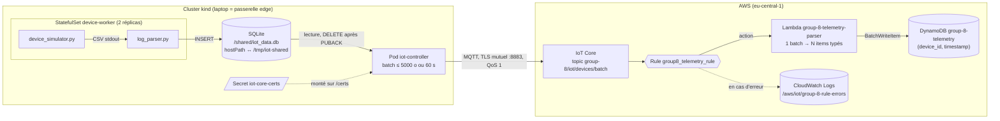

# Pipeline AWS IoT Core → DynamoDB

Ce document décrit la mise en place de la chaîne complète entre l'edge (cluster kind) et AWS :

```
simulateur → log_parser → SQLite → iot-controller ──MQTT/TLS──▶ AWS IoT Core ──Rule──▶ Lambda ──▶ DynamoDB
```

État : **fonctionnel de bout en bout**. Prochaine étape : dashboard Grafana.

## Architecture



Points clés :

- **Pattern passerelle** : seul le contrôleur est un « Thing » IoT Core. Les machines à café sont identifiées par `device_id` dans les données, pas par une identité MQTT. Un seul certificat et une seule connexion par site.
- **Store-and-forward** : si la connexion tombe, les lignes restent dans SQLite et sont renvoyées plus tard. Une ligne n'est supprimée qu'après l'ACK (PUBACK) du broker.
- **Livraison au moins une fois** : un batch peut arriver deux fois (ACK perdu), mais la clé DynamoDB `(device_id, timestamp)` rend l'écriture idempotente → pas de doublons dans la table.
- **IoT Core ne stocke rien** : sans Rule, les messages sont acquittés puis perdus.

## Noms des ressources

Tout est préfixé `group-8` car le compte AWS peut être partagé (un client ID MQTT identique entre deux groupes provoquerait des déconnexions mutuelles).

| Ressource | Nom |
|---|---|
| Région | `eu-central-1` (Francfort) |
| IoT Policy | `group-8-iot-gateway-policy` |
| IoT Thing | `group-8-iot-gateway-01` |
| Client ID MQTT | `group-8-iot-controller` |
| Topic MQTT | `group-8/iot/devices/batch` |
| Table DynamoDB | `group-8-telemetry` |
| Lambda | `group-8-telemetry-parser` |
| Policy IAM de la Lambda (inline) | `group-8-telemetry-write` |
| IoT Rule | `group8_telemetry_rule` (les `-` sont interdits dans les noms de règles) |
| Log group erreurs de la règle | `/aws/iot/group-8-rule-errors` |
| Rôle IAM de l'action d'erreur | `group-8-iot-rule-errors-role` |
| Secret Kubernetes | `iot-core-certs` |
| Images Docker Hub | `madeinshinea/cloud-project:controller-1.0.0`, `madeinshinea/cloud-project:worker-1.0.0` |

## 1. AWS IoT Core

### Policy

`IoT Core → Security → Policies → Create policy` (JSON). Moindre privilège : uniquement se connecter avec notre client ID et publier sur notre topic.

```json
{
  "Version": "2012-10-17",
  "Statement": [
    { "Effect": "Allow", "Action": "iot:Connect",
      "Resource": "arn:aws:iot:eu-central-1:<ACCOUNT_ID>:client/group-8-iot-controller" },
    { "Effect": "Allow", "Action": "iot:Publish",
      "Resource": "arn:aws:iot:eu-central-1:<ACCOUNT_ID>:topic/group-8/iot/devices/batch" }
  ]
}
```

`<ACCOUNT_ID>` : `aws sts get-caller-identity --query Account --output text`.

### Thing et certificat

`IoT Core → Manage → All devices → Things → Create things → Create single thing` (et **pas** l'assistant « Connect one device », qui crée une policy de démo `sdk/test/*` inutilisable ici).

- Nom : `group-8-iot-gateway-01`, pas de shadow
- *Auto-generate a new certificate*
- Attacher la policy `group-8-iot-gateway-policy`
- **Télécharger immédiatement** le certificat, la clé privée et Amazon Root CA 1 (la clé privée n'est plus téléchargeable ensuite)

Les fichiers sont rangés dans `edge-device/deployment/certs/` (ignoré par git) :

```
certs/
├── AmazonRootCA1.pem    # vérifie l'identité d'AWS
├── device.pem.crt       # identité du contrôleur
└── private.pem.key      # preuve de possession (chmod 600, ne jamais commiter)
```

La clé publique et Root CA 3 (certificats ECC) ne sont pas nécessaires.

### Endpoint

```nu
aws iot describe-endpoint --endpoint-type iot:Data-ATS --region eu-central-1
```

### Test de connexion sans le code

Abonnement dans `IoT Core → MQTT test client` à `group-8/iot/devices/batch`, puis depuis `edge-device/deployment/certs` (Nushell) :

```nu
docker run --rm -v $"($env.PWD):/c" docker.io/library/eclipse-mosquitto mosquitto_pub --cafile /c/AmazonRootCA1.pem --cert /c/device.pem.crt --key /c/private.pem.key -h (aws iot describe-endpoint --endpoint-type iot:Data-ATS --region eu-central-1 | from json | get endpointAddress) -p 8883 -i group-8-iot-controller -t group-8/iot/devices/batch -m '{"rows":["hello"]}' -q 1 -d
```

Ce test valide certificat, policy, endpoint et réseau indépendamment du code Python.

## 2. Contrôleur edge (`edge-device/deployment/iot-controller/controller.py`)

### Changements

| Changement | Raison |
|---|---|
| `CLIENT_ID`, `GATEWAY_ID`, `CA_CERT`, `CERT_FILE`, `KEY_FILE`, `MAX_WAIT`, `PUBLISH_TIMEOUT` en variables d'environnement | Client ID imposé par la policy ; chemins des certificats différents entre laptop et pod |
| TLS mutuel activé seulement si `CA_CERT` est défini | La même image fonctionne avec Mosquitto en local (sans TLS) |
| `mqtt.Client(mqtt.CallbackAPIVersion.VERSION2, …)` | Requis par paho-mqtt 2.x |
| Payload `{"gateway": "...", "rows": [...]}` en JSON compact | Un objet JSON est plus simple à traiter dans la Rule et la Lambda qu'un tableau nu |
| Calcul exact de la taille du payload (enveloppe + virgules) | Ne jamais dépasser 5 KB |
| Envoi si **batch plein** OU **plus vieille ligne > `MAX_WAIT`** | Voir « Coût du batching » |
| `wait_for_publish(timeout)` + suppression seulement si `is_published()` | Pas de perte de données ni de blocage infini si la connexion tombe |
| Callbacks `on_connect` / `on_disconnect` | IoT Core coupe la connexion sans message en cas de refus de policy |

### Coût du batching

IoT Core facture les messages **par tranche de 5 KB** : un message de 700 o coûte autant qu'un message de 5 KB, et un message de 6 KB compte double.

- Avant : envoi à chaque poll (~10 lignes / 10 s) → ~8 640 messages/jour pour 2 machines
- Après : batch rempli jusqu'à ~5000 o ou envoyé après 60 s → ~1 440 messages/jour, soit **~6× moins cher**
- Contrepartie : jusqu'à ~60 s de latence avant que les données arrivent dans le cloud

Un batch typique : ~62 lignes, ~4,3 KB, envoyé toutes les ~62 s.

### Variables d'environnement (pod)

| Variable | Valeur |
|---|---|
| `MQTT_HOST` | endpoint ATS (`…-ats.iot.eu-central-1.amazonaws.com`) |
| `MQTT_PORT` | `8883` |
| `CLIENT_ID` | `group-8-iot-controller` |
| `GATEWAY_ID` | `group-8-iot-gateway-01` |
| `TOPIC` | `group-8/iot/devices/batch` |
| `CA_CERT` / `CERT_FILE` / `KEY_FILE` | `/certs/AmazonRootCA1.pem`, `/certs/device.pem.crt`, `/certs/private.pem.key` |
| `DB_PATH` | `/shared/iot_data.db` |
| `MAX_BYTES` | `5000` |
| `MAX_WAIT` | `60` |
| `POLL_INTERVAL` | `2.0` |

### Test local (hors Kubernetes)

Le contrôleur peut tourner directement sur le laptop, en lisant la base remplie par les workers via `/tmp/iot-shared`. Depuis la racine du projet, après avoir supprimé le pod contrôleur (un seul client par client ID) :

```nu
with-env {MQTT_HOST: (aws iot describe-endpoint --endpoint-type iot:Data-ATS --region eu-central-1 | from json | get endpointAddress), MQTT_PORT: "8883", CLIENT_ID: "group-8-iot-controller", GATEWAY_ID: "group-8-iot-gateway-01", TOPIC: "group-8/iot/devices/batch", CA_CERT: "edge-device/deployment/certs/AmazonRootCA1.pem", CERT_FILE: "edge-device/deployment/certs/device.pem.crt", KEY_FILE: "edge-device/deployment/certs/private.pem.key", DB_PATH: "/tmp/iot-shared/iot_data.db", MAX_WAIT: "60"} { uv run --with paho-mqtt==2.1.0 python edge-device/deployment/iot-controller/controller.py }
```

## 3. Déploiement Kubernetes

### Images (Docker Hub)

Un seul dépôt Docker Hub, les deux images sont distinguées par leur tag. Depuis la racine :

```nu
docker login docker.io -u madeinshinea      # mot de passe = access token Read & Write
docker build -t docker.io/madeinshinea/cloud-project:controller-1.0.0 edge-device/deployment/iot-controller
docker push docker.io/madeinshinea/cloud-project:controller-1.0.0
docker build -t docker.io/madeinshinea/cloud-project:worker-1.0.0 edge-device/deployment/simulator
docker push docker.io/madeinshinea/cloud-project:worker-1.0.0
```

Toujours utiliser un **nouveau tag** à chaque modification : avec `imagePullPolicy: IfNotPresent`, un nœud qui a déjà un tag ne le retélécharge jamais.

### Secret des certificats

Les certificats ne doivent être ni dans l'image (publique sur Docker Hub) ni dans le YAML (commité). Ils sont injectés via un Secret Kubernetes, monté en lecture seule sur `/certs` dans le pod. Depuis `edge-device/` :

```nu
kubectl create secret generic iot-core-certs --from-file=deployment/certs/AmazonRootCA1.pem --from-file=deployment/certs/device.pem.crt --from-file=deployment/certs/private.pem.key
```

Le Secret disparaît avec le cluster : à recréer après chaque `kind create cluster`. Un Secret n'est qu'encodé en base64 (pas chiffré) : acceptable pour kind en local.

### Cluster kind

Le cluster a 2 nœuds : `control-plane` et `worker`. Les deux montent le même dossier du laptop (`/tmp/iot-shared` → `/shared`), donc la base SQLite partagée par `hostPath` est la même quel que soit le nœud où tournent les pods.

Le passage à l'échelle se fait en ajoutant des passerelles (une par site, chacune avec son Thing et son certificat).

### Lancement (depuis `edge-device/`)

```nu
kind create cluster --config kind-config.yaml --name iot-cluster
kubectl create secret generic iot-core-certs --from-file=deployment/certs/AmazonRootCA1.pem --from-file=deployment/certs/device.pem.crt --from-file=deployment/certs/private.pem.key
kubectl apply -f deployment/statefulset-worker.yaml
kubectl apply -f deployment/pod-iot-controller.yaml
kubectl logs -f iot-controller
```

## 4. DynamoDB

`DynamoDB → Tables → Create table` :

| Paramètre | Valeur | Raison |
|---|---|---|
| Nom | `group-8-telemetry` | |
| Partition key | `device_id` (String) | Répartit les données par machine |
| Sort key | `timestamp` (Number, epoch ms) | Requête « machine X entre A et B » = lecture directe par clé, sans scan |
| Capacity mode | On-demand | Coût nul à l'arrêt, absorbe les rafales de ~60 écritures par batch sans throttling, rien à dimensionner. Modifiable plus tard (1×/24 h) |
| TTL | attribut `ttl` | Suppression automatique des vieilles lignes |

Remarques :

- `timestamp` est un **mot réservé** DynamoDB : écrire des items fonctionne normalement, mais dans les requêtes il faut l'échapper (`#ts` + `ExpressionAttributeNames` avec boto3, `"timestamp"` entre guillemets doubles en PartiQL, comme le nom de table `"group-8-telemetry"` à cause des `-`).
- Le TTL exige des **secondes** epoch, alors que `timestamp` est en millisecondes : la Lambda écrit donc un attribut séparé `ttl`.
- Rétention : **90 jours** à partir du `timestamp` de chaque échantillon. La suppression par TTL est gratuite mais asynchrone (généralement sous quelques jours après expiration).

## 5. Lambda `group-8-telemetry-parser`

Code : [`cloud/lambda/telemetry-parser/lambda_function.py`](../cloud/lambda/telemetry-parser/lambda_function.py)

Pourquoi une Lambda : l'action DynamoDB native d'une Rule écrit **un item par message MQTT**. Or nos messages sont des batches de ~60 lignes CSV ; la Rule ne sait ni découper un tableau ni parser du CSV. La Lambda transforme chaque ligne en item typé :

```
"1792000000000,coffee-machine-0,28000,52.0,1400204.6,50030,preheat,0"
  → {device_id, timestamp, uptime_ms, temperature_c, power_consumption_mw,
     heap_free_bytes, device_status, error_code, gateway, ttl}
```

- Les lignes invalides sont ignorées et loguées (au lieu de faire échouer tout le batch).
- `batch_writer` regroupe les écritures en `BatchWriteItem` de 25 items.
- Les flottants passent par `Decimal` (boto3 refuse les `float`).

Pourquoi le parsing est dans le cloud et pas dans le contrôleur :

- L'edge n'a besoin que d'un certificat limité à un topic, pas de clés IAM capables d'écrire en base.
- Changer le schéma ou la base = redéployer la Lambda, pas mettre à jour chaque passerelle.
- Le CSV est compact : le convertir à l'edge en JSON grossirait les messages (2-3×) donc la facture IoT Core.
- Passer par une Rule permet d'ajouter d'autres actions plus tard (alertes, archivage S3) sans toucher l'edge.

### Configuration

| Paramètre | Valeur |
|---|---|
| Runtime | Python 3.x (dernière version) |
| Architecture | `arm64` (Graviton, ~20 % moins cher, aucun impact pour du Python pur) |
| Timeout | 10 s (3 s par défaut, trop court au démarrage à froid) |
| `TABLE_NAME` | `group-8-telemetry` |
| `RETENTION_DAYS` | `90` |
| Rôle | créé automatiquement (*basic Lambda permissions* → logs CloudWatch) + policy inline `group-8-telemetry-write` |

Policy inline `group-8-telemetry-write` (écriture sur cette seule table) :

```json
{
  "Version": "2012-10-17",
  "Statement": [
    {
      "Effect": "Allow",
      "Action": ["dynamodb:BatchWriteItem", "dynamodb:PutItem"],
      "Resource": "arn:aws:dynamodb:eu-central-1:<ACCOUNT_ID>:table/group-8-telemetry"
    }
  ]
}
```

L'ARN de la table se trouve dans `DynamoDB → Tables → group-8-telemetry → Overview → General information → Additional info`.

### Déploiement depuis le repo

Depuis `cloud/lambda/telemetry-parser/` (le zip est ignoré par git) :

```nu
python -m zipfile -c function.zip lambda_function.py
aws lambda update-function-code --function-name group-8-telemetry-parser --zip-file fileb://function.zip --region eu-central-1
```

### Test isolé

Événement de test `sample-batch` dans l'onglet *Test* :

```json
{
  "gateway": "group-8-iot-gateway-01",
  "rows": [
    "1792000000000,coffee-machine-0,28000,52.0,1400204.6,50030,preheat,0",
    "1792000002000,coffee-machine-0,30000,55.5,1399767.0,49893,standby,0",
    "1792000000000,coffee-machine-1,12000,90.1,1500000.0,48000,error,1",
    "this,is,not,valid"
  ]
}
```

Résultat attendu : `{"written": 3, "skipped": 1}` et 3 items dans la table.

## 6. IoT Rule `group8_telemetry_rule`

`IoT Core → Message routing → Rules → Create rule` (et cliquer **Create** à la dernière étape de l'assistant, sinon la règle n'existe pas).

| Paramètre | Valeur |
|---|---|
| SQL version | `2016-03-23` |
| SQL | `SELECT * FROM 'group-8/iot/devices/batch'` (guillemets simples) |
| Action | Lambda → `group-8-telemetry-parser` (la console ajoute la permission d'invocation pour `iot.amazonaws.com`) |
| Error action | CloudWatch Logs → `/aws/iot/group-8-rule-errors`, rôle `group-8-iot-rule-errors-role`, **batch mode désactivé** |

- L'action d'erreur reçoit un objet JSON par échec ; le *batch mode* attend un tableau d'entrées de log et ferait échouer l'action d'erreur elle-même.
- Rétention des log groups (`/aws/iot/group-8-rule-errors` et `/aws/lambda/group-8-telemetry-parser`) : 2 semaines (par défaut *Never expire*).
- Une règle ne s'applique qu'aux messages publiés **après** sa création.

## Vérification de bout en bout

1. `kubectl logs -f iot-controller` : `Connecté au broker : Success` puis un `Envoi MQTT d'un batch …` / `Batch envoyé et purgé…` toutes les ~60 s
2. `CloudWatch → Log groups → /aws/lambda/group-8-telemetry-parser` : `[+] group-8-iot-gateway-01 : ~60 lignes écrites, 0 ignorées`
3. `DynamoDB → group-8-telemetry → Explore table items` : items de `coffee-machine-0` et `coffee-machine-1`
4. `/aws/iot/group-8-rule-errors` : vide

## Arrêt (économiser les crédits)

Depuis `edge-device/` :

```nu
kubectl delete -f deployment/pod-iot-controller.yaml
kubectl scale statefulset device-worker --replicas=0     # relancer avec --replicas=2
```

Ou tout supprimer : `kind delete cluster --name iot-cluster` (le Secret est à recréer ensuite). Pour repartir d'une base vide :

```nu
rm -f /tmp/iot-shared/iot_data.db /tmp/iot-shared/iot_data.db-shm /tmp/iot-shared/iot_data.db-wal
```

Sinon, au redémarrage, le contrôleur envoie d'un coup tout l'arriéré accumulé.

Ordres de grandeur pour 2 machines en continu :

- IoT Core : ~1 440 messages/jour ≈ 0,002 $/jour ; Thing, certificat et policy gratuits
- Lambda : ~1 440 invocations/jour, dans le free tier
- DynamoDB : ~86 400 écritures/jour (1 par échantillon), soit quelques dollars par mois en 24/7 ; stockage 90 jours ≈ 1,5-2 GB. **Les écritures DynamoDB dominent le coût**, pas les messages IoT

## Dépannage rencontré

| Problème | Cause / solution |
|---|---|
| Assistant « Connect one device » | Crée une policy de démo (`sdk/test/*`) incompatible : détacher et attacher `group-8-iot-gateway-policy` |
| `requested access to the resource is denied` au push | Pas connecté au bon compte ou token Docker Hub en lecture seule |
| Connexion / déconnexion en boucle | Deux contrôleurs (local + pod) avec le même client ID |
| Batches envoyés mais aucun log Lambda ni erreur | La règle n'avait pas été créée (vérifier `IoT Core → Message routing → Rules`, région eu-central-1, statut Active, SQL exact) |

## Prochaine étape : Grafana

Le data source DynamoDB de Grafana est un **plugin Enterprise** (non installable sur Grafana OSS auto-hébergé). Options sur AWS :

| Option | Coût | Effort |
|---|---|---|
| Amazon Managed Grafana + licence Enterprise plugins | ~9 $ par éditeur + 45 $ par utilisateur actif / mois | Faible |
| Grafana OSS sur EC2 + plugin Infinity → Lambda qui interroge DynamoDB | instance EC2 | Moyen |
| Grafana OSS + Athena (connecteur DynamoDB) | par requête Athena | Élevé |

Exemple de requête PartiQL :

```sql
SELECT "timestamp", temperature_c FROM "group-8-telemetry"
WHERE device_id = 'coffee-machine-0' AND "timestamp" > 1792000000000
```
